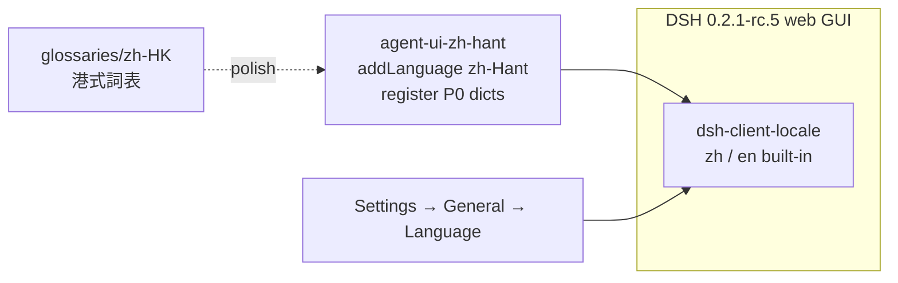

# agent-ui-zh-hant

**狀態：M0 scaffold（繁中語包／港式詞表）——唔係完整全介面覆蓋。**

KINFX 用嘅 **DSH 相容** Web GUI **繁體中文（香港）** locale pack：以官方 API `addLanguage`＋`register` 注入 `zh-Hant`（fallback `zh`），P0 命名空間含 `common`／`settings`／`chat`／`sidebar`（另附 `conversation`、`settings.locale`）。  
**同 DeepSeek、xAI 或其他 LLM 廠商無隸屬關係（Not affiliated）。** 技術段可寫「相容 DSH（DeepSeek Harness）」。

宿主釘選：`@deepseek-ai/dsh@0.2.1-rc.5`（內建語系只有 `zh`／`en`）。  
**唔**用 `@mimateinn/dsh-i18n` 做主線（peer 對 0.2.x 不相容）。**唔**整樹 fork harness。獨立於 L0 `agent-home-recipes`。

## English (short)

M0 **Traditional Chinese (Hong Kong)** locale pack for a DSH-compatible web GUI. Registers `zh-Hant` via official `@deepseek-ai/dsh-client-locale` APIs. P0 namespaces: `common`, `settings`, `chat`, `sidebar`. MIT. No secrets. Not affiliated with DeepSeek or other LLM vendors. Desktop chrome / hardcoded strings remain out of scope (see gaps).

## 架構示意



*(Placeholder diagram — M0 has no runtime converter; dicts are pre-baked.)*

## 圖文占位

| 步驟 | 截圖／GIF（稍後補） |
|------|---------------------|
| 安裝插件後重啟 | `docs/images/install.png`（占位） |
| Language 選「繁體中文（香港）」 | `docs/images/language-picker.png`（占位） |
| 側欄「新對話」等港式用詞 | `docs/images/sidebar-hk.png`（占位） |

## 一鍵安裝

本插件係 **dsh bundle**（`dsh.bundle.patch` → `cordis.patch.yml` insert），`dsh plugin add` 會寫入 profile layer，唔係 plain dependency。

```bash
# 1) 釘宿主（若未裝）
npm i -g @deepseek-ai/dsh@0.2.1-rc.5

# 2) 用本機路徑加 bundle 插件（發佈前）
export DSH_HOME="${DSH_HOME:-$HOME/.agent-ui-zh-hant-dsh}"
mkdir -p "$DSH_HOME"
dsh plugin --profile web add /absolute/path/to/agent-ui-zh-hant

# 3) 重啟宿主／Web GUI，然後：
#    Settings → General → Language → 繁體中文（香港）
```

公開 npm／GitHub 後可改：

```bash
dsh plugin --profile web add agent-ui-zh-hant
# 或：dsh plugin --profile web add github:Kinfxhk/agent-ui-zh-hant
```

密鑰唔需要、亦唔應寫入本庫。只有空嘅 [`.env.example`](.env.example)。

## 本地檢查

```bash
npm run check          # 檔案／JSON／插件 export／粗略 secret 掃描
npm run extract:outline  # 打印抽取步驟（唔寫檔）
# 有本機 dsh 時可重抽簡中源：
# npm run extract
# 改 dicts/zh-Hant 後：node scripts/embed.mjs
```

## P0 覆蓋

| ns | 來源包（抽取） | M0 |
|----|----------------|----|
| `common` | `dsh-client-locale` | ✅ |
| `settings` | `dsh-client-ui-settings-general` | ✅ |
| `chat` | `dsh-client-ui-chat` | ✅ |
| `sidebar` | `dsh-client-ui-sidebar` | ✅ |
| `conversation` | `dsh-client-ui-conversation` | ✅ 附送 |
| `settings.locale` | `dsh-client-locale` | ✅ 附送 |

港式詞見 [`glossaries/zh-HK.md`](glossaries/zh-HK.md)。缺口見 [`docs/gaps.md`](docs/gaps.md)。

## Desktop／硬編碼缺口（必讀）

- **Desktop 原生選單**（Application／Edit…）唔經 client locale → 仍 en／簡中。
- **內聯 text map**、**第三方插件文案**、**註冊時凍結字串** → 語包覆蓋唔到。
- 其餘未註冊 ns → fallback `zh` → `en`。

## 合規

*Not affiliated with DeepSeek or other vendors. Not legal advice. No secrets in git. Locale strings derived from a local dsh install are transformed for zh-Hant/HK; respect upstream licenses.*

## 授權

MIT · Copyright (c) 2026 KINFX · 見 [LICENSE](LICENSE) / [NOTICE](NOTICE)
